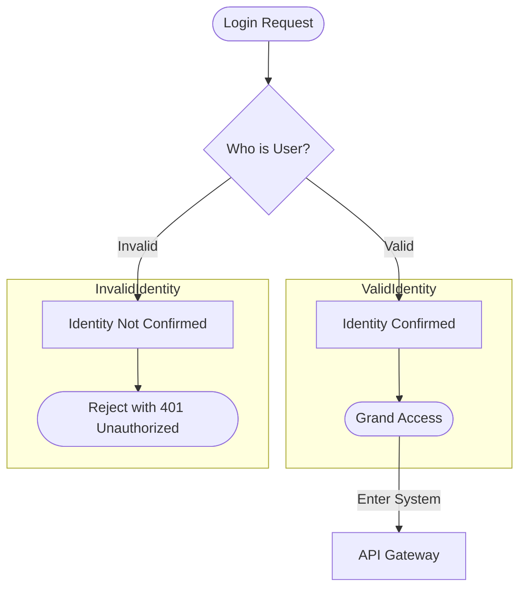

# Web Security 101

**Goal:** Learn web security concepts practically. 

- Authentication **methods** and trade-offs
- Authentication **frameworks** (OAuth2)
- SSO

## Authentication

Security process of verifying the identity of a
(i) user,
(ii) device,
(iii) or system
to prove they are who they claim to be.

### Types

- Basic
- Digest
- API Keys
- Session
- Bearer & JWT Tokens
- Access & Refresh Tokens
- OAuth2 
- OpenID Connect
- OSS (SAML,  OIDC, OAuth2)

### Flow

